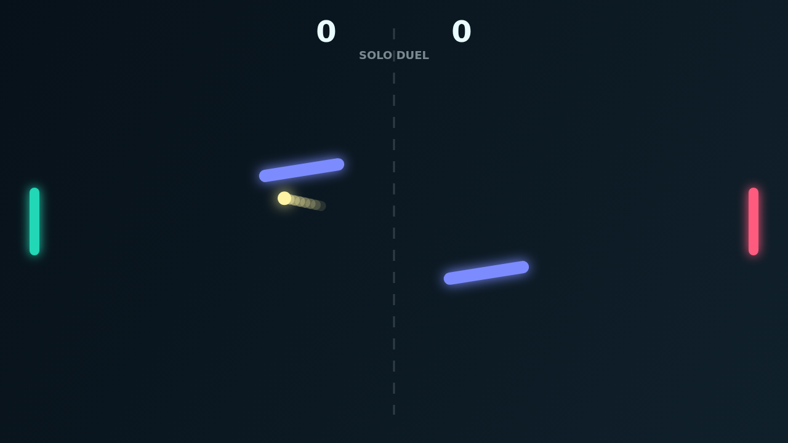

# Carom

Carom is a paddle duel about making the ball misbehave on purpose. The opening
serve looks familiar for a heartbeat, then the center obstacles begin to sway
and rotate, turning every return into a choice between a clean shot and a risky
bank.

The paddles are simple to move, but timing matters. Hit while sliding upward or
downward and the ball carries spin after contact, bending its path just enough
to wrong-foot the other side or clip an obstacle at a new angle.

Solo mode gives you an AI defender to pressure; Versus turns the same field into
a local keyboard duel. Points come quickly, but match point still asks for a
two-point lead, so the last rallies have room for desperate curves and sharp
rebounds.
